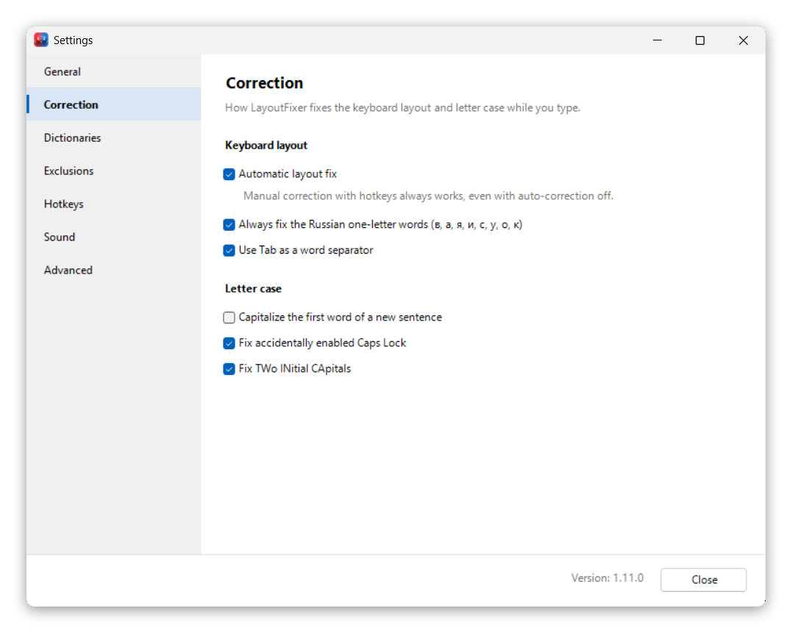
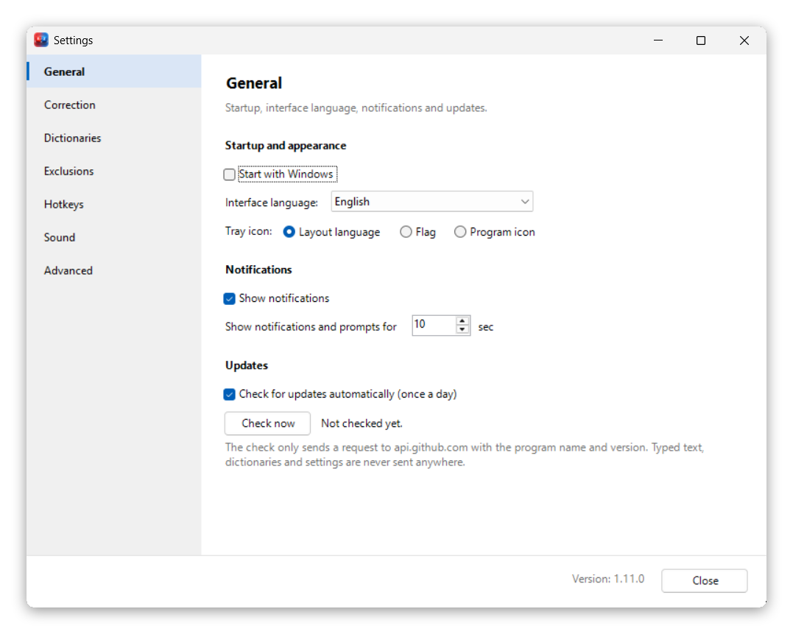
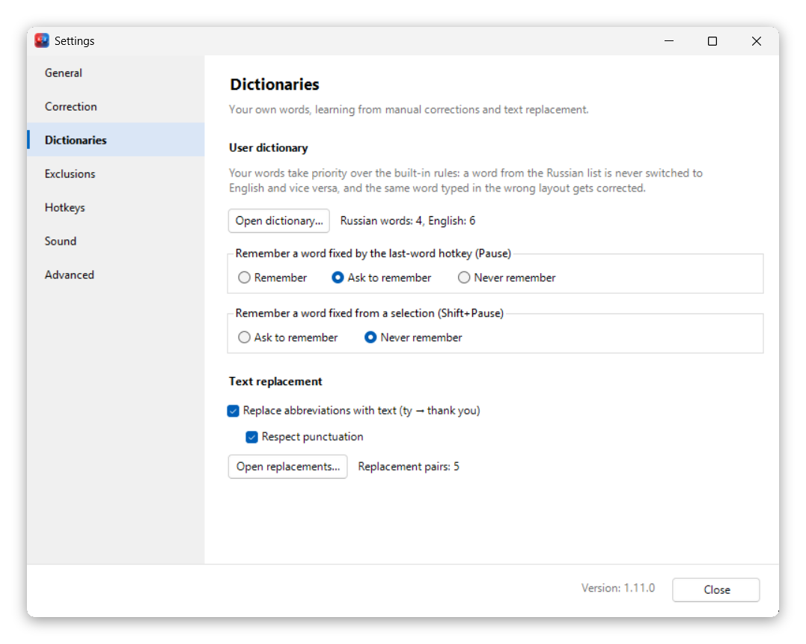
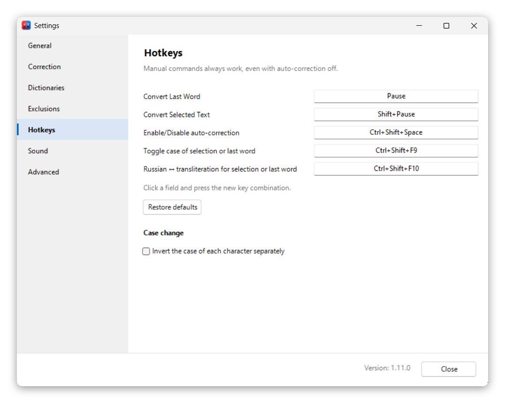
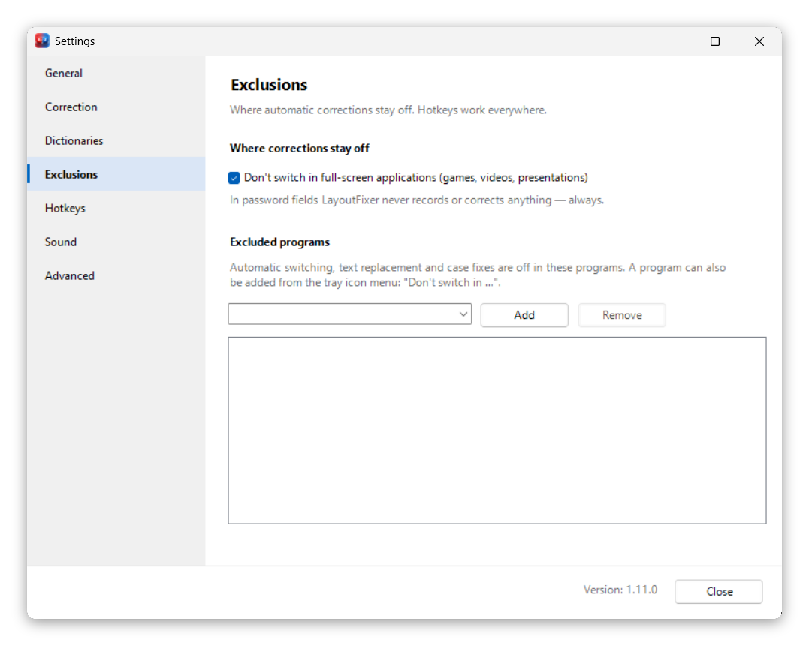
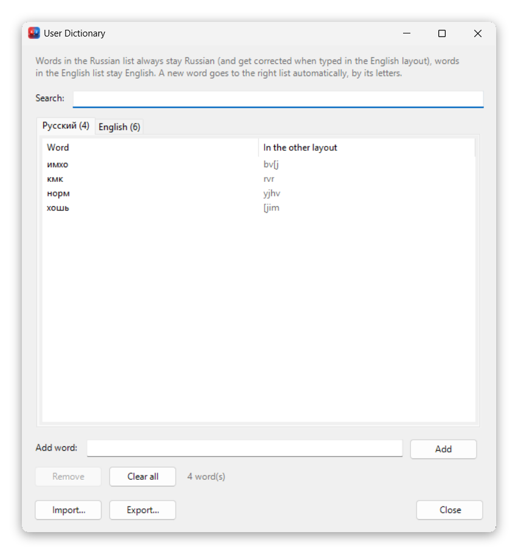
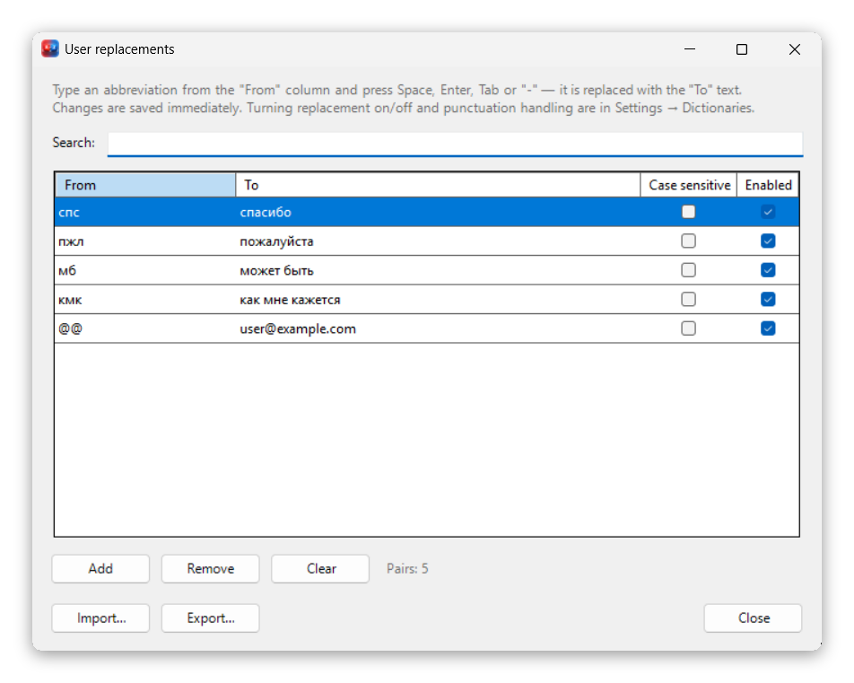
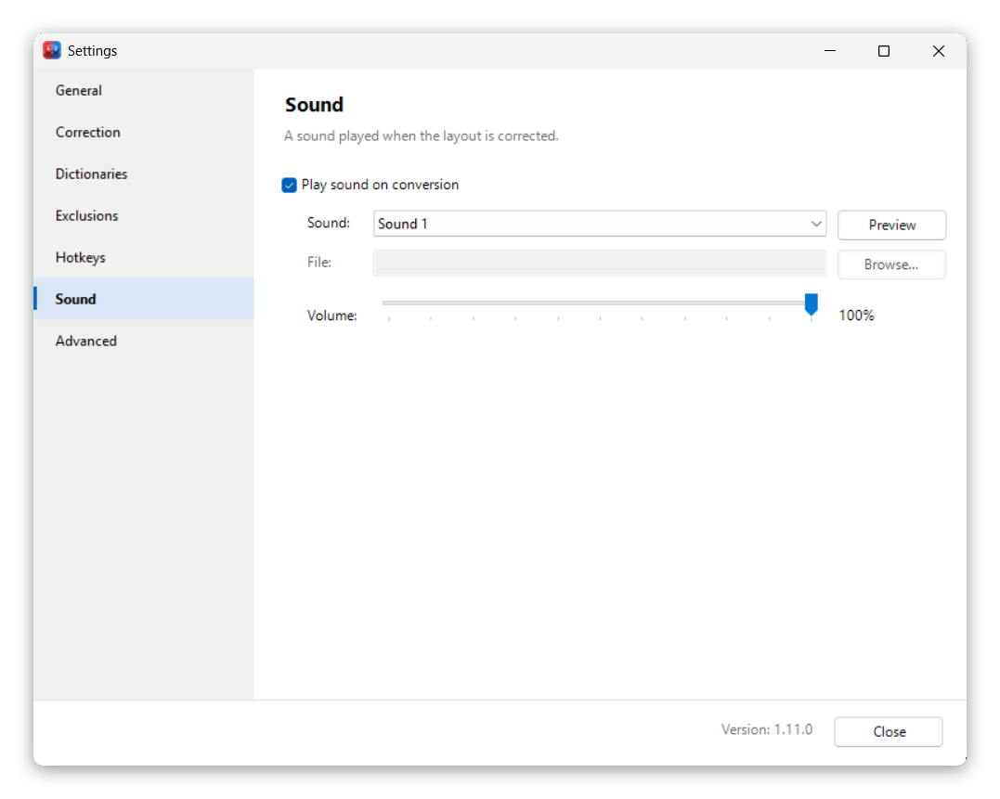
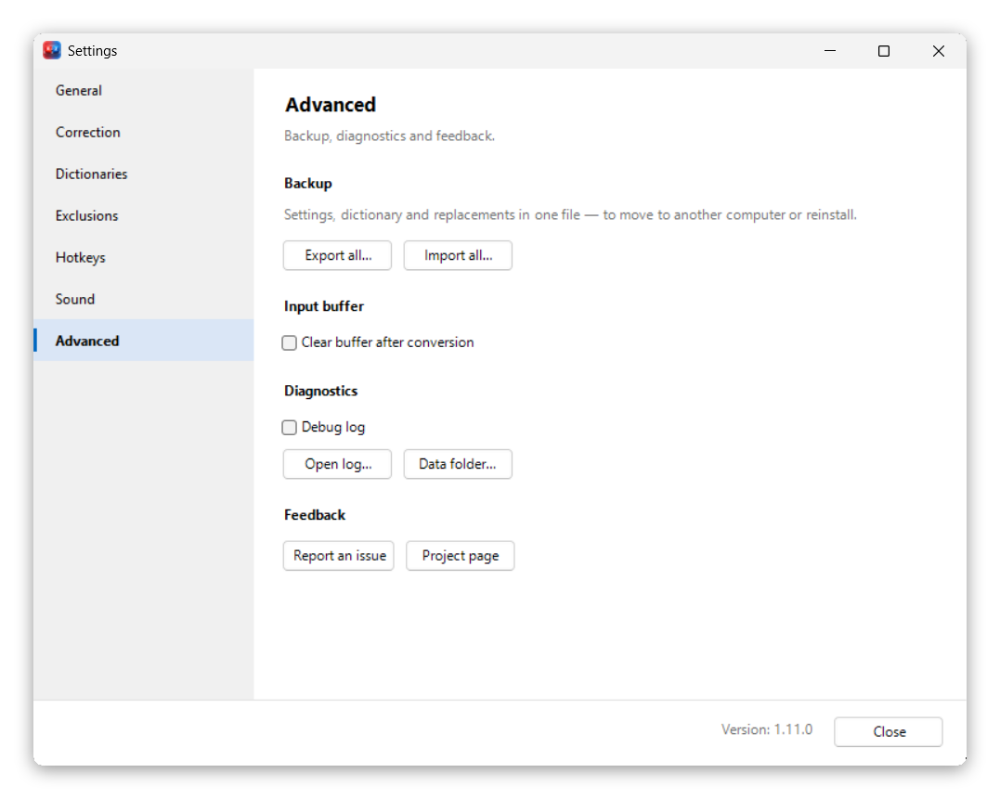
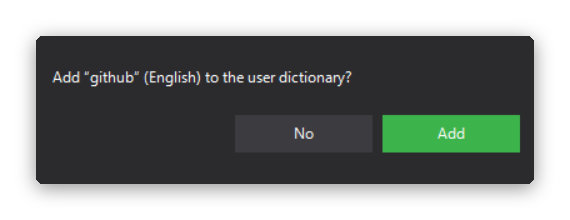

<div align="center">


# LayoutFixer

**Automatic Russian/English keyboard layout fixer for Windows**

Typed `ghbdtn` instead of `привет`, or `руддщ` instead of `hello`? LayoutFixer
notices it while you type, fixes the word and switches the layout for you.

[](https://github.com/MBudkin/LayoutFixer/releases/latest)
[](https://github.com/MBudkin/LayoutFixer/releases)
[](LICENSE)


[**⬇ Download**](https://github.com/MBudkin/LayoutFixer/releases/latest) ·
[Features](#features) ·
[Screenshots](#screenshots) ·
[Hotkeys](#hotkeys) ·
[FAQ](#faq) ·
[Русский](README.md)

</div>

---

## What it is

LayoutFixer is a small Windows tray utility for people who type in two
languages. It watches your typing and fixes words typed in the wrong keyboard
layout automatically. When you want to fix something by hand, just press
`Pause/Break`.

| You typed | You get | What happened |
|---|---|---|
| `ghbdtn vbh` | `привет мир` | Russian words typed in the English layout |
| `руддщ цщкдв` | `hello world` | English words typed in the Russian layout |
| `Claude b ChatGPT` | `Claude и ChatGPT` | a Russian one-letter word between English terms |
| `СрфеПЗЕ` | `ChatGPT` | a mixed-case name |
| `dSGBIB` *(Caps Lock)* | `Выпиши` | layout, case and Caps Lock at once |
| `THis` | `This` | TWo INitial CApitals |
| `brb` | `be right back` | your own text replacement |

**LayoutFixer is open source** ([MIT License](LICENSE)). No ads, no telemetry,
no account. Nothing you type ever leaves your computer.

## Features

- ⚡ **Fixes while you type.** When the beginning of a word is clearly typed in
  the wrong layout, it is fixed right away and you keep typing in the right
  one. Everything else is checked after Space, `Enter`, `Tab` or `-`.
- 💬 **Messenger-friendly.** The fixed word reaches the app before the `Enter`
  key, so the message is sent without the typo.
- 🧠 **Knows word forms, slang and terms.** Besides word tables it uses letter
  language models for Russian and English. On independent 50,000-word frequency
  lists it fixes about 99% of wrong-layout words and wrongly changes about
  0.06% of correct ones.
- 🇷🇺 **Built for Russian text full of English terms.** `Claude и ChatGPT`,
  `API и SDK`, `docker и kubernetes`: the Russian one-letter words are fixed and
  the layout stays English for the next term.
- ↩️ **One key to undo.** `Pause/Break` reverts a fix and remembers your choice.
  The same key fixes the last word or the selected text by hand.
- 📖 **Personal dictionary.** Your words always win: `github` stays `github`,
  and `пшерги` becomes `github`.
- ✂️ **Text replacement.** `brb` → `be right back`, `@@` → your e-mail.
- 🔠 **Letter case.** Accidental Caps Lock (`hELLO`), TWo INitial CApitals,
  sentence capitalization, case change and transliteration of the selection
  with hotkeys.
- 🛡️ **Stays out of the way.** Off in password fields, games and other
  full-screen apps, programs from your exclusion list, and while a third layout
  (e.g. Ukrainian) is active.
- 🔔 **Tells you about updates**, but never downloads or installs anything itself.
- 🌐 Russian and English user interface.

## Screenshots

<div align="center">



</div>

<details>
<summary><b>More screenshots</b></summary>
<br>

| | |
|---|---|
|  |  |
| General | Dictionaries and replacements |
|  |  |
| Hotkeys | Exclusions |
|  |  |
| User dictionary | Text replacement |
|  |  |
| Sound | Advanced |

<p align="center">
<br>
After a manual fix the program can offer to remember the word
</p>

</details>

## Installation

1. Open the [latest release](https://github.com/MBudkin/LayoutFixer/releases/latest)
   and download one of the archives:

   | Archive | Size | Choose it when |
   |---|---|---|
   | `LayoutFixer-<version>-win-x64.zip` | ~70 MB | **Recommended.** Everything included, nothing to install |
   | `LayoutFixer-<version>-framework.zip` | ~1 MB | You already have the [.NET 10 Desktop Runtime](https://dotnet.microsoft.com/download/dotnet/10.0) |

2. Unpack it into any folder, e.g. `C:\Programs\LayoutFixer`, and run
   `LayoutFixer.exe`. The icon appears in the notification area next to the
   clock.
3. To start it with Windows, turn on
   **Settings → General → Start with Windows**.

> [!NOTE]
> The program is not code-signed, so Windows SmartScreen may warn you on the
> first start. Click **More info → Run anyway**. The source code is open: you
> can review it and [build it yourself](#building-from-source).

**Requirements:** 64-bit Windows 10 or 11. No administrator rights needed.

**Updating:** exit the program (right-click the icon → Exit) and replace
`LayoutFixer.exe` with the new one. Settings and dictionaries live separately
in `%AppData%\LayoutFixer` and are kept.

## Hotkeys

| Keys | Action |
|---|---|
| `Pause` | Fix the last word. Press again to revert |
| `Shift` + `Pause` | Fix the selected text |
| `Ctrl` + `Shift` + `F9` | Change the case of the selection or the last word |
| `Ctrl` + `Shift` + `F10` | Cyrillic ↔ transliteration for the selection or the last word |
| `Ctrl` + `Shift` + `Space` | Turn automatic correction on or off |

Change any of them in **Settings → Hotkeys**: click a field and press the new
combination. Manual commands always work, even with automatic correction off.
On laptops `Pause/Break` often needs `Fn`. If there is no such key, assign
another combination.

## How it works

Every word is judged by several independent signals, from the most reliable to
the weakest:

1. **Your dictionary** always wins.
2. **Short-word frequencies**: `yt` → `не`, `ns` → `ты`, while `it` and `at`
   stay English.
3. **Word and word-start tables** for Russian and English.
4. **Letter language models** recognise words that are in no table: inflected
   forms, rare words, slang (`cksifk` → `слышал`).
5. **Prefixes and endings** as a weak fallback.

If a fix was wrong, press `Pause`: the word comes back and stays as typed. The
program can offer to remember the word; see
**Settings → Dictionaries**.

## Privacy

- Only settings and your dictionaries are stored (`%AppData%\LayoutFixer`).
  There is no typing history: only the last 128 typed characters are kept in
  memory for corrections, until the program exits.
- What you type into password fields does not even enter that buffer.
- The only network access is the optional update check: a request to
  `api.github.com` with the program name and version and none of your data. It
  can be turned off in **Settings → General**.
- The debug log is off by default. Turn it on only to investigate a problem and
  delete it afterwards.

## FAQ

<details>
<summary><b>Nothing is fixed in a particular program</b></summary>

- If that program runs as administrator, Windows hides its input from normal
  programs. Run LayoutFixer as administrator too.
- Check **Settings → Exclusions** and the full-screen option.
- Password fields are skipped on purpose.
</details>

<details>
<summary><b>A word was fixed although it shouldn't have been</b></summary>

Press `Pause` right after the fix: the word comes back and stays as typed. If it
keeps happening, add the word to your dictionary (the program offers it
itself).
</details>

<details>
<summary><b>I don't want "b" after an English word to become "и"</b></summary>

Turn off **Settings → Correction → Always fix the Russian one-letter words**.
Such a letter will then be fixed only after capitalised names
(`Claude b ChatGPT`) and inside sentences that already have Russian words.
</details>

<details>
<summary><b>My antivirus is suspicious of the program</b></summary>

To see your typing, LayoutFixer uses a standard Windows mechanism, a low-level
keyboard hook (`WH_KEYBOARD_LL`), which some antivirus products treat with
caution. The program neither records nor sends anything, and its source code is
open for review.
</details>

<details>
<summary><b>How do I move my settings to another computer?</b></summary>

**Settings → Advanced → Backup** saves settings, dictionary and replacements
into a single file; restore it on the other computer from the same place.
</details>

## Building from source

You need the [.NET 10 SDK](https://dotnet.microsoft.com/download/dotnet/10.0)
(or run `.\.dotnet-install.ps1` to install it locally into the project folder).

```powershell
git clone https://github.com/MBudkin/LayoutFixer.git
cd LayoutFixer
.\build.ps1                       # tests + all build variants into publish\
.\build.ps1 -Variant win-x64      # self-contained build only
dotnet test .\tests\LayoutFixer.Tests\LayoutFixer.Tests.csproj
```

The design is described in [`docs/ARCHITECTURE.md`](docs/ARCHITECTURE.md), the
editing rules in [`docs/CONTRIBUTING.md`](docs/CONTRIBUTING.md), and the logic
invariants that must not be broken in [`AGENTS.md`](AGENTS.md) (these documents
are in Russian). Change history: [`CHANGELOG.md`](CHANGELOG.md).

## Contributing

Found a bug or have an idea? [Open an issue](https://github.com/MBudkin/LayoutFixer/issues).
For a wrong correction, please include the word you typed and the active
layout. Pull requests are welcome; please read
[`docs/CONTRIBUTING.md`](docs/CONTRIBUTING.md) first.

## License

The code is licensed under the [MIT License](LICENSE): use, modify and share it
freely.

The word tables in `src/LayoutFixer/Resources/Dictionaries` are derived from
third-party frequency lists and are distributed under the terms of those
sources, for non-commercial use. See [`NOTICE.md`](NOTICE.md) for details and
attribution.
