<div align="center">

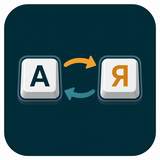

# LayoutFixer

**Автоматическое исправление русско-английской раскладки для Windows**

Набрали `ghbdtn` вместо `привет`? LayoutFixer заметит ошибку ещё во время набора,
исправит слово и сам переключит раскладку.

[](https://github.com/MBudkin/LayoutFixer/releases/latest)
[](https://github.com/MBudkin/LayoutFixer/releases)
[](LICENSE)


[**⬇ Скачать**](https://github.com/MBudkin/LayoutFixer/releases/latest) ·
[Возможности](#возможности) ·
[Скриншоты](#скриншоты) ·
[Горячие клавиши](#горячие-клавиши) ·
[Вопросы и ответы](#вопросы-и-ответы) ·
[English](README.en.md)

</div>

---

## Что это

LayoutFixer — небольшая программа в области уведомлений Windows для тех, кто
пишет на двух языках. Она следит за набором и исправляет слова, набранные не в
той раскладке, — сразу, без нажатия клавиш. А если исправлять нужно вручную,
достаточно нажать `Pause/Break`.

| Вы набрали | Получилось | Что произошло |
|---|---|---|
| `ghbdtn vbh` | `привет мир` | русские слова в английской раскладке |
| `руддщ цщкдв` | `hello world` | английские слова в русской раскладке |
| `Claude b ChatGPT` | `Claude и ChatGPT` | однобуквенное слово среди английских терминов |
| `СрфеПЗЕ` | `ChatGPT` | название со смешанным регистром |
| `dSGBIB` *(Caps Lock)* | `Выпиши` | раскладка, регистр и Caps Lock сразу |
| `ПРивет` | `Привет` | ДВе ЗАглавные буквы |
| `спс` | `спасибо` | ваша автозамена |

**LayoutFixer — проект с открытым исходным кодом** (лицензия [MIT](LICENSE)).
Без рекламы, без телеметрии, без регистрации. Набранный текст никуда не
отправляется.

## Возможности

- ⚡ **Исправление во время набора.** Если начало слова однозначно набрано не в
  той раскладке, слово исправляется сразу, и дальше вы печатаете уже в
  правильной раскладке. Остальное проверяется после пробела, `Enter`, `Tab`
  или `-`.
- 💬 **Удобно в мессенджерах.** Исправленное слово уходит в программу раньше,
  чем `Enter`, поэтому сообщение отправится уже без опечатки.
- 🧠 **Понимает формы слов, сленг и термины.** Кроме словарей используются
  буквенные языковые модели русского и английского языков. На частотных
  списках из 50 000 слов программа исправляет около 99 % слов, набранных в
  неправильной раскладке, а правильные слова ошибочно меняет примерно в
  0,06 % случаев.
- 🇷🇺 **Рассчитана на русский текст с английскими терминами.** `Claude и
  ChatGPT`, `API и SDK`, `docker и kubernetes`: однобуквенные «в», «а», «я», «и»,
  «с», «у», «о», «к» исправляются, а раскладка остаётся английской для
  следующего термина.
- ↩️ **Всё отменяется одной клавишей.** `Pause/Break` возвращает исправленное
  слово обратно и запоминает ваш выбор. Им же можно вручную исправить
  последнее слово или выделенный текст.
- 📖 **Пользовательский словарь.** Ваши слова всегда в приоритете:
  `github` останется `github`, а `пшерги` превратится в `github`.
- ✂️ **Автозамена.** `спс` → `спасибо`, `@@` → ваш адрес почты.
- 🔠 **Регистр букв.** Исправление случайно включённого Caps Lock (`пРИВЕТ`),
  ДВух ЗАглавных букв, заглавная буква в начале предложения, смена регистра и
  транслит выделенного текста горячими клавишами.
- 🛡️ **Не мешает там, где не нужно.** Не работает в полях ввода пароля, в
  играх и полноэкранных приложениях, в программах из вашего списка исключений
  и при третьей раскладке (например, украинской).
- 🔔 **Сообщает об обновлениях**, но ничего не скачивает и не устанавливает сам.
- 🌐 Интерфейс на русском и английском языках.

## Скриншоты

<div align="center">

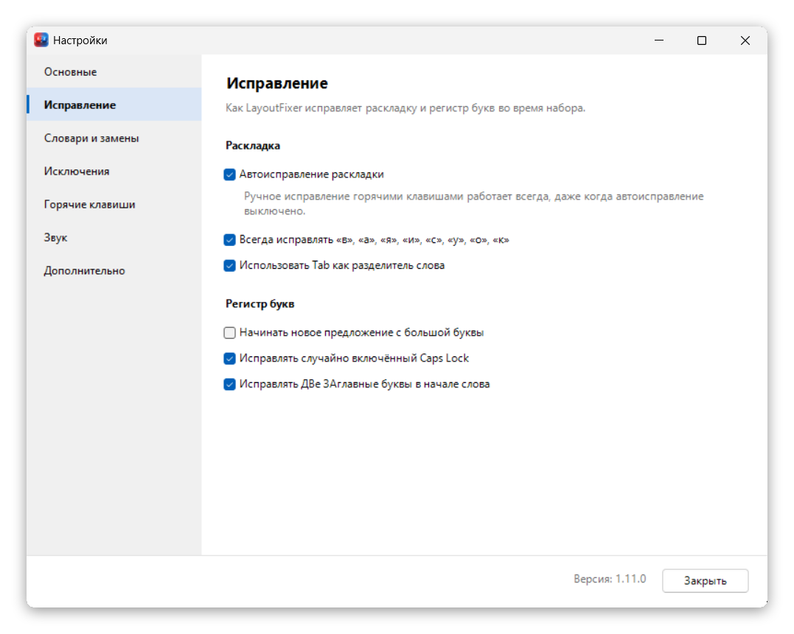

</div>

<details>
<summary><b>Ещё скриншоты</b></summary>
<br>

| | |
|---|---|
| 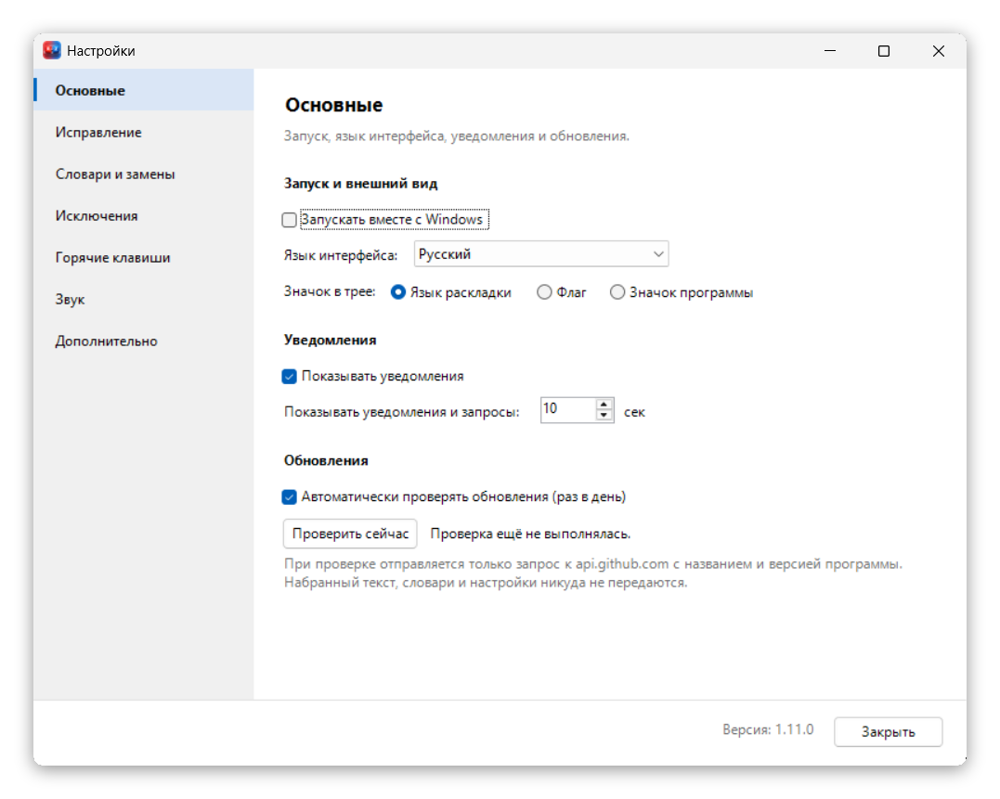 | 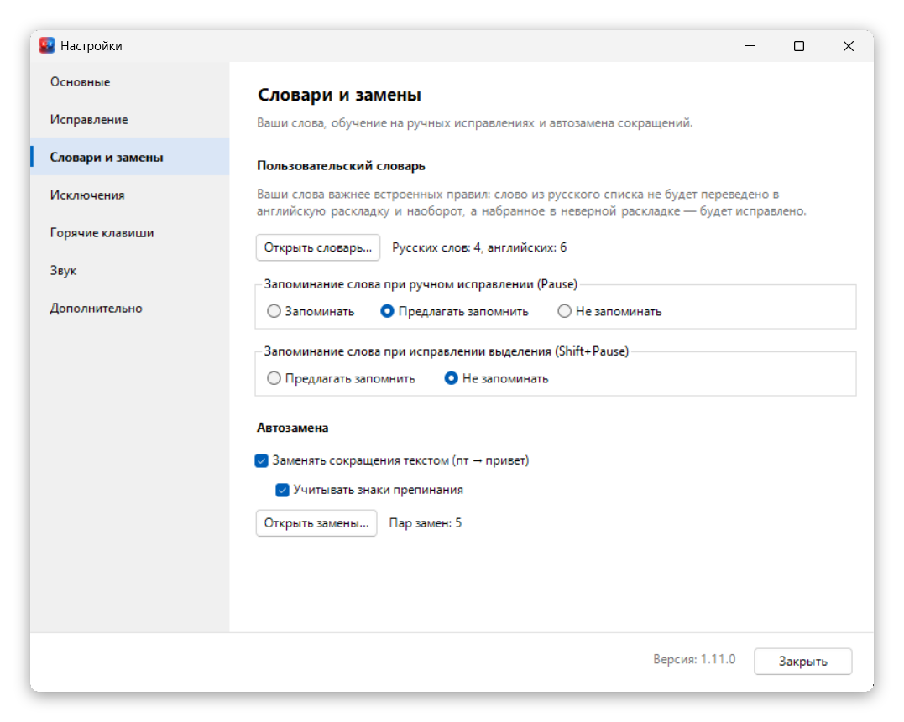 |
| Основные настройки | Словари и замены |
| 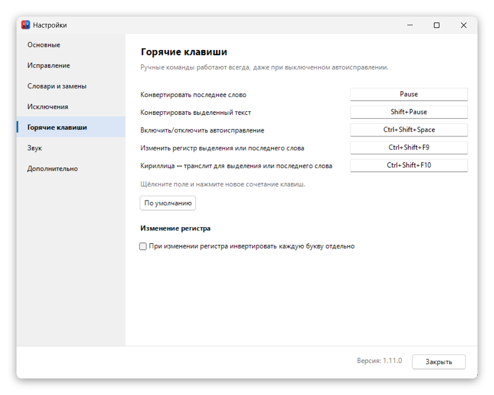 | 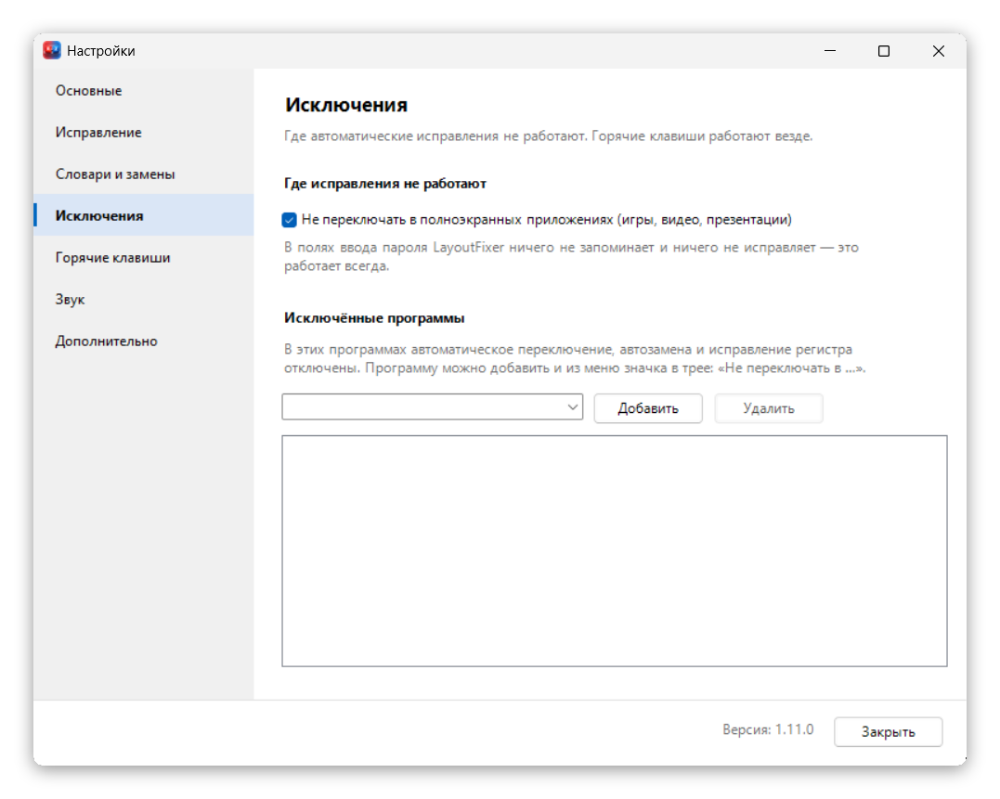 |
| Горячие клавиши | Исключения |
| 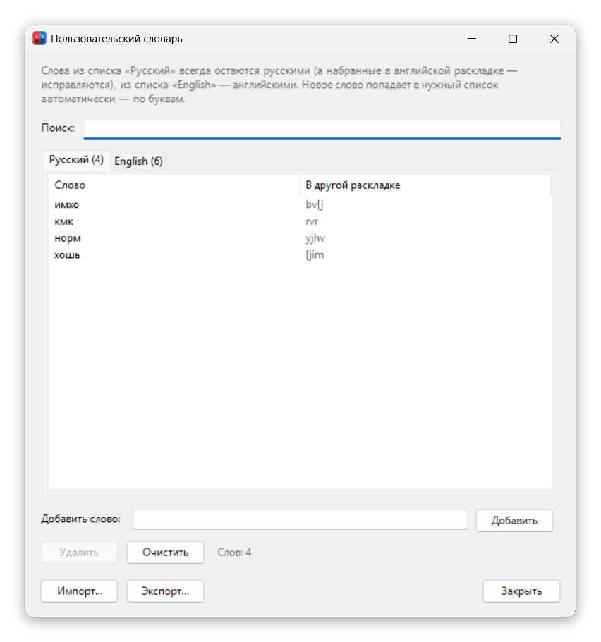 | 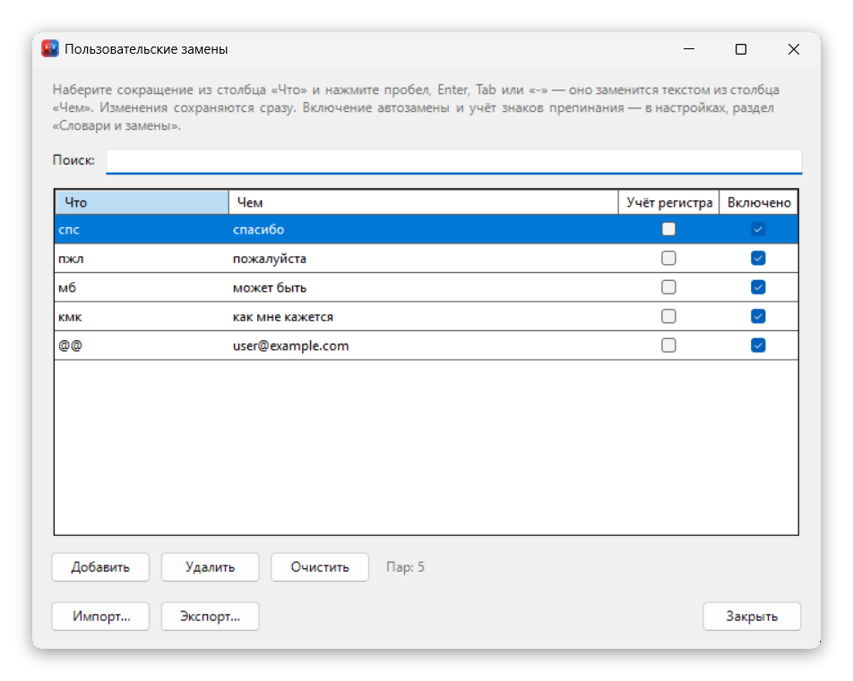 |
| Пользовательский словарь | Автозамена |
| 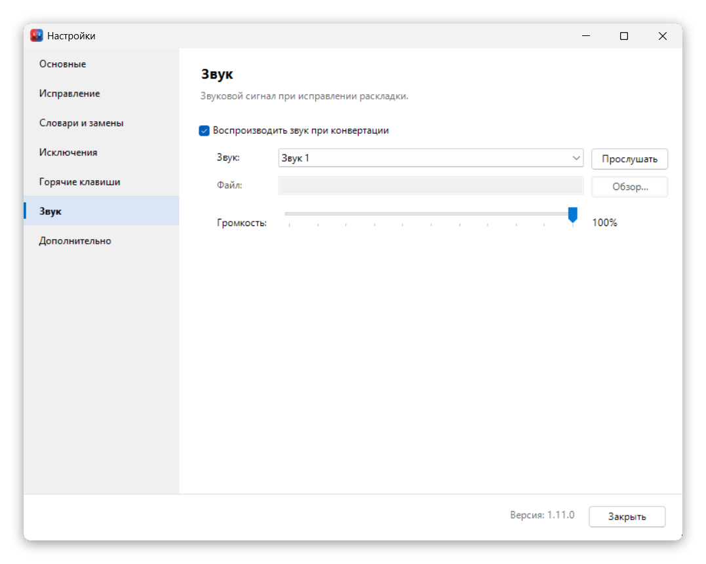 | 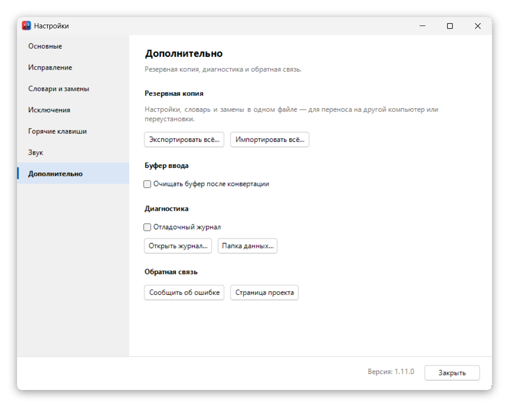 |
| Звук | Дополнительно |

<p align="center">
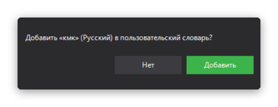<br>
После ручного исправления программа может предложить запомнить слово
</p>

</details>

## Установка

1. Откройте [страницу последнего выпуска](https://github.com/MBudkin/LayoutFixer/releases/latest)
   и скачайте один из архивов:

   | Архив | Размер | Когда выбрать |
   |---|---|---|
   | `LayoutFixer-<версия>-win-x64.zip` | ~70 МБ | **Рекомендуется.** Всё включено, ничего устанавливать не нужно |
   | `LayoutFixer-<версия>-framework.zip` | ~1 МБ | Если у вас уже установлен [.NET 10 Desktop Runtime](https://dotnet.microsoft.com/download/dotnet/10.0) |

2. Распакуйте архив в любую папку, например `C:\Programs\LayoutFixer`, и
   запустите `LayoutFixer.exe`. Программа появится в области уведомлений рядом
   с часами.
3. Чтобы программа запускалась вместе с Windows, включите
   **«Настройки → Основные → Запускать вместе с Windows»**.

> [!NOTE]
> Программа не подписана цифровой подписью, поэтому при первом запуске Windows
> SmartScreen может показать предупреждение. Нажмите **«Подробнее» →
> «Выполнить в любом случае»**. Исходный код программы открыт, его можно
> проверить и [собрать самостоятельно](#сборка-из-исходного-кода).

**Требования:** Windows 10 или 11 (64-разрядная). Права администратора не нужны.

**Обновление:** закройте программу (правый щелчок по значку → «Выход») и
замените `LayoutFixer.exe` новым. Настройки и словари хранятся отдельно в
`%AppData%\LayoutFixer` и сохранятся.

## Горячие клавиши

| Клавиши | Действие |
|---|---|
| `Pause` | Исправить последнее слово. Повторное нажатие возвращает его обратно |
| `Shift` + `Pause` | Исправить выделенный текст |
| `Ctrl` + `Shift` + `F9` | Изменить регистр выделения или последнего слова |
| `Ctrl` + `Shift` + `F10` | Кириллица ↔ транслит для выделения или последнего слова |
| `Ctrl` + `Shift` + `Space` | Включить или выключить автоисправление |

Все сочетания меняются в **«Настройки → Горячие клавиши»**: щёлкните поле и
нажмите нужное сочетание. Ручные команды работают всегда, даже при
выключенном автоисправлении. На ноутбуках клавиша `Pause/Break` часто
нажимается через `Fn`. Если её нет, назначьте другое сочетание.

## Как это работает

Решение для каждого слова принимается по нескольким независимым признакам, от
самого надёжного к самому слабому:

1. **Ваш словарь** — всегда в приоритете.
2. **Частотность коротких слов** — `yt` → `не`, `ns` → `ты`, но `it` и `at`
   остаются английскими.
3. **Таблицы слов и начал слов** русского и английского языков.
4. **Буквенные языковые модели** — распознают слова, которых нет ни в одной
   таблице: формы слов, редкие слова, сленг (`cksifk` → `слышал`).
5. **Приставки и окончания** — слабый запасной признак.

Если программа ошиблась, нажмите `Pause`: слово вернётся и останется как
набрано. Программа может предложить запомнить слово в
словаре; это настраивается в **«Настройки → Словари и замены»**.

## Конфиденциальность

- Программа хранит только настройки и ваши словари (`%AppData%\LayoutFixer`).
  Истории набранного текста нет: в памяти держатся только последние
  128 набранных символов, нужные для исправления, и только до перезапуска.
- То, что набирается в полях ввода пароля, не попадает даже в этот буфер.
- Единственное обращение к сети — необязательная проверка обновлений: запрос к
  `api.github.com` с названием и версией программы, без каких-либо ваших
  данных. Отключается в **«Настройки → Основные»**.
- Отладочный журнал по умолчанию выключен. Включайте его только для поиска
  ошибки и удаляйте после.

## Вопросы и ответы

<details>
<summary><b>Программа не исправляет текст в какой-то программе</b></summary>

- Если программа запущена от имени администратора, Windows не даёт обычным
  программам видеть набор в её окнах. Запустите LayoutFixer тоже от имени
  администратора.
- Проверьте список **«Настройки → Исключения»** и пункт «Не переключать в
  полноэкранных приложениях».
- В полях ввода пароля программа не работает намеренно.
</details>

<details>
<summary><b>Программа исправила слово, а не надо было</b></summary>

Нажмите `Pause` сразу после исправления: слово вернётся и останется как
набрано. Если такое повторяется, добавьте слово в
пользовательский словарь (программа предложит это сама).
</details>

<details>
<summary><b>Не хочу, чтобы «b» после английского слова становилась «и»</b></summary>

Снимите галочку **«Настройки → Исправление → Всегда исправлять «в», «а», «я»,
«и», «с», «у», «о», «к»»**. Тогда такая буква будет исправляться только после
названий с заглавной буквы (`Claude b ChatGPT`) и в предложениях, где уже есть
русские слова.
</details>

<details>
<summary><b>Антивирус ругается на программу</b></summary>

Чтобы видеть набор, LayoutFixer использует стандартный механизм Windows —
низкоуровневый клавиатурный хук (`WH_KEYBOARD_LL`). Некоторые антивирусы
относятся к этому настороженно. Программа ничего не записывает и не
отправляет, а исходный код открыт для проверки.
</details>

<details>
<summary><b>Как перенести настройки на другой компьютер</b></summary>

**«Настройки → Дополнительно → Резервная копия»** сохраняет настройки, словарь
и автозамену в один файл. На другом компьютере восстановите их оттуда же.
</details>

## Сборка из исходного кода

Нужен [.NET 10 SDK](https://dotnet.microsoft.com/download/dotnet/10.0)
(или скрипт `.\.dotnet-install.ps1`, который установит его локально в папку
проекта).

```powershell
git clone https://github.com/MBudkin/LayoutFixer.git
cd LayoutFixer
.\build.ps1                       # тесты + все варианты сборки в publish\
.\build.ps1 -Variant win-x64      # только автономная сборка
dotnet test .\tests\LayoutFixer.Tests\LayoutFixer.Tests.csproj
```

Устройство программы описано в [`docs/ARCHITECTURE.md`](docs/ARCHITECTURE.md),
правила правок — в [`docs/CONTRIBUTING.md`](docs/CONTRIBUTING.md), а важные
инварианты логики, которые нельзя нарушать, — в [`AGENTS.md`](AGENTS.md).
История изменений — [`CHANGELOG.md`](CHANGELOG.md).

## Участие в разработке

Нашли ошибку или есть идея? [Создайте issue](https://github.com/MBudkin/LayoutFixer/issues).
Чтобы разобраться с неверным исправлением, приложите слово, которое вы
набирали, и какая раскладка была включена. Pull request'ы приветствуются,
только прочитайте перед этим [`docs/CONTRIBUTING.md`](docs/CONTRIBUTING.md).

## Лицензия

Код распространяется по лицензии [MIT](LICENSE) — пользуйтесь, изменяйте и
распространяйте свободно.

Таблицы слов в `src/LayoutFixer/Resources/Dictionaries` получены из сторонних
частотных словарей и распространяются на условиях этих источников, для
некоммерческого использования. Подробности и авторы — в [`NOTICE.md`](NOTICE.md).
